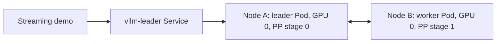

# 03: Serve a model across nodes with pipeline parallelism

Deploy [Muse Glimmer 30B](https://huggingface.co/meta-models/Muse-Glimmer-30B/tree/cec94fcfd6512f2cfe708138c32533b346ea4f69) from [lesson 02](../02-tensor-parallel/README.md) across two nodes, with one NVIDIA L40 GPU per node. LeaderWorkerSet (LWS) manages both Pods as one model replica.

## How pipeline parallelism differs from tensor parallelism

Pipeline parallelism (PP) splits model layers into stages. Each stage sends intermediate activations to the next stage. Both stages cooperate on each request.

PP can also run within one node. This lesson uses two nodes to demonstrate distributed inference.



## What you will deploy

Open [vllm.yaml](vllm.yaml) and compare it with [lesson 02's manifest](../02-tensor-parallel/vllm.yaml).

| Setting | Value |
| --- | --- |
| Model and image | Same pinned BF16 Muse Glimmer revision and vLLM 0.33.0 image as lesson 02 |
| Model replicas | `1`, comprising a leader Pod and a worker Pod |
| GPU allocation | One GPU per Pod, two GPUs total |
| Placement | Required Pod anti-affinity keeps the Pods on different nodes |
| Parallelism | TP `1`, PP `2` |
| Runtime | Native multiprocessing (`mp`), with two nodes |
| Context and concurrency | 2,048 tokens per sequence, at most eight active sequences |
| GPU memory budget | 90% of each GPU's memory |

LWS provides node counts, ranks, and rendezvous settings through `LWS_GROUP_SIZE`, `LWS_WORKER_INDEX`, and `LWS_LEADER_ADDRESS`.

Only the leader exposes the HTTP API through `vllm-leader`. The worker runs with `--headless`. LWS creates the headless `vllm` Service for Pod discovery.

`LeaderCreated` lets the worker start before leader readiness. The leader needs the worker to finish initialization. `RecreateGroupOnPodRestart` restarts both Pods if either Pod or container restarts. Updates replace the old group without extra GPUs.

## 1. Check your workspace

Complete [lesson 02's cleanup](../02-tensor-parallel/README.md#6-clean-up) first. Its `vllm` Service would block LWS discovery.

In the terminal you used for lesson 02, enter this lesson:

```bash
cd ../03-pipeline-parallel
kubectl api-resources --api-group=leaderworkerset.x-k8s.io
```

Expect the `leaderworkersets` resource. Ask the organizer if LWS is unavailable. Check your GPU quota:

```bash
kubectl get resourcequota gpu-quota
```

Expect GPU quota usage of `0/2`. If usage is not `0/2`, finish the previous lesson's cleanup. Wait for Pod deletion and repeat the check.

> ⚠️ **Caution:**
> The cluster needs two GPU nodes with one free L40 GPU on each. Two free GPUs on one node cannot satisfy this lesson's anti-affinity rule.

## 2. Deploy and inspect both Pods

Find `size: 2`, `--pipeline-parallel-size`, `--nnodes`, `--node-rank`, and the anti-affinity rules in [vllm.yaml](vllm.yaml). Apply it:

```bash
kubectl apply -f vllm.yaml
```

Kubernetes creates `leaderworkerset.leaderworkerset.x-k8s.io/vllm` and `service/vllm-leader`. Check the group:

```bash
kubectl get leaderworkerset vllm
```

Expect one model replica. It becomes ready after both stages initialize. Check the Pod placement:

```bash
kubectl get pods -o wide
```

Expect `vllm-0` (leader) and `vllm-0-1` (worker). Their `NODE` columns should differ. Wait for the leader's API startup before sending requests.

## 3. Inspect the stages

Follow the leader Pod's logs:

```bash
kubectl logs -f vllm-0
```

Look for PP rank 0, model loading, GPU KV-cache capacity, and the leader's API startup. Press `Ctrl+C` to stop following logs. Follow the worker Pod's logs:

```bash
kubectl logs -f vllm-0-1
```

Look for PP rank 1 and worker initialization. Press `Ctrl+C` to stop following logs.

Inspect the leader's GPU:

```bash
kubectl exec vllm-0 -- nvidia-smi
```

The leader should see one GPU with model memory in use. Inspect the worker:

```bash
kubectl exec vllm-0-1 -- nvidia-smi
```

The worker should also see one GPU with model memory in use. Both GPUs may appear as device 0 inside their respective containers, even though they serve different pipeline stages.

## 4. Send a streaming request

Set the Service URL and list the model:

```bash
export VLLM_BASE_URL="http://vllm-leader.${NAMESPACE}.svc:8000"
curl --fail-with-body -sS -m 30 \
  "${VLLM_BASE_URL}/v1/models" | jq '.data[].id'
```

Expect `"meta-models/Muse-Glimmer-30B"`. Start the shared demo:

```bash
export VLLM_MODEL="meta-models/Muse-Glimmer-30B"
export VLLM_MAX_OUTPUT_TOKENS=512
python ../server/demo.py
```

Open <http://127.0.0.1:8080/>. Enter a prompt and click **Generate**. Expect the reply to stream.

Try lesson 02's prompts and output limits. Compare time to first token and overall output rate. Cross-node communication and pipeline scheduling can slow a single request. Both parallelism and node placement changed, so neither effect is isolated.

Press `Ctrl+C` to stop the demo server.

## 5. Watch the metrics

Print the monitoring dashboard link:

```bash
echo -e "\n${WORKSHOP_GRAFANA_URL}\n"
```

Open the printed link. Expect the overview with your workload namespace selected.

Run four concurrent requests:

```bash
python ../server/traffic.py --concurrency 4
```

Expect one summary after one minute, with `failed=0`. Find GPU activity for both Pods on different nodes.

The engine panels show the leader. The headless worker has no HTTP metrics endpoint; its GPU still appears in the GPU panels.

## 6. Clean up

From the `03-pipeline-parallel` folder, run:

```bash
kubectl delete -f vllm.yaml
```

Kubernetes deletes the LeaderWorkerSet, its Pods, and the Service, and releases both GPUs.

## 7. Next exercise

Continue with [04: Separate prefill and decode with NVIDIA Dynamo](../04-prefill-disaggregation/README.md).

## Troubleshooting

If startup fails, inspect the group, Pods, and events:

```bash
kubectl describe leaderworkerset vllm
```

Read the group status and controller events. Inspect the Pods:

```bash
kubectl describe pods -l leaderworkerset.sigs.k8s.io/name=vllm
```

Read the container states and scheduling events. Inspect recent events:

```bash
kubectl get events --sort-by=.metadata.creationTimestamp
```

Look for scheduling, quota, admission, or container failures.

- For `no matches for kind "LeaderWorkerSet"`, ask the organizer to install LWS. For `Forbidden`, ask the organizer to grant LWS access in your workload namespace.
- For `Pending`, check quota, capacity on two different nodes, and anti-affinity scheduling events. If no Pods exist, inspect `kubectl get statefulsets` and `kubectl describe statefulsets` for quota or admission errors.
- If quota is exhausted and `deployment/vllm` still exists, the previous Deployment owns the GPUs. Complete lesson 02's cleanup. A discovery Service error saying `controller owner nil` also indicates that its old `vllm` Service remains.
- For rendezvous or NCCL timeouts, inspect both logs. Keep `VLLM_HOST_IP` set to each Pod's IP and ensure that DNS and bidirectional Pod communication between nodes are allowed. The runtime also uses dynamically allocated ports; opening only the HTTP port is insufficient.
- For repeated group restarts, inspect both Pods' previous logs with `kubectl logs vllm-0 --previous --tail=200` and `kubectl logs vllm-0-1 --previous --tail=200`. LWS can replace a failed Pod, so also check the events.
- For GPU memory errors, retain TP `1`, PP `2`, the `2048` context limit, and the `0.9` memory budget. For missing model files, check `/models/meta-models/Muse-Glimmer-30B/cec94fcfd6512f2cfe708138c32533b346ea4f69/config.json` and ask the organizer to check hydration.

See the [vLLM 0.33.0 LWS example](https://docs.vllm.ai/en/v0.33.0/deployment/frameworks/lws/) and [parallelism guide](https://docs.vllm.ai/en/v0.33.0/serving/parallelism_scaling/) for the native multiprocessing setup and larger TP/PP combinations.
