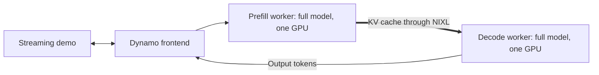

# 04: Separate prefill and decode with NVIDIA Dynamo

Deploy [Gemma 4 12B IT](https://huggingface.co/google/gemma-4-12B-it/tree/707f0a3b8a3c7ad586ed01e27eafbad8a27dd0f7) with NVIDIA Dynamo and its vLLM backend. Use one GPU for prefill and one GPU for decode.

## How prefill disaggregation differs from pipeline parallelism

Prefill processes the prompt and creates the attention key-value (KV) cache. Decode uses that cache to generate output tokens.

In lesson 03, each GPU held different model layers. Here, each GPU holds a complete copy of the model. The workers perform different phases of each request.

The Dynamo frontend coordinates the workers and exposes an OpenAI-compatible API. NVIDIA Inference Xfer Library (NIXL) transfers the KV cache between workers.



Production deployments can scale the two worker pools independently. This exercise keeps one worker in each pool to use two GPUs.

## What you will deploy

Open [dynamo.yaml](dynamo.yaml).

| Setting | Value |
| --- | --- |
| Controller | NVIDIA Dynamo Operator 1.6.0, `DynamoGraphDeployment` API `v1beta1` |
| Runtime | Dynamo 1.6.0 with its bundled vLLM 0.31.0, pinned by image digest |
| Pods | One CPU frontend, one prefill worker, and one decode worker; one GPU per worker |
| Context and concurrency | 2,048 tokens per sequence, at most eight active sequences per worker |
| KV cache | 2 GiB per worker, with unified allocation and CPU buffers for transfer |
| Transfer | NIXL with UCX over TCP, without RDMA or CUDA IPC |
| Storage | Read-only `workshop-models` PVC on all three Pods |

BF16 Gemma fits on one L40 per worker. BF16 Muse Glimmer would need two GPUs per worker, exceeding the two-GPU quota.

The workers serve text only and disable thinking by default. The `gemma4` reasoning parser handles the model's response markers.

The workers disable hybrid KV-cache allocation to use CPU transfer buffers. Sliding-window attention remains enabled. Keep `--disable-hybrid-kv-cache-manager` on both workers to prevent corrupt output.

The workers use `NixlConnector` with roles `kv_producer` for prefill and `kv_consumer` for decode. Keep their model, dtype, and cache settings aligned.

The operator supplies Deployments, Services, probes, shared memory, and discovery permissions. Updates use `Recreate`.

> ℹ️ **Note:**
> This exercise demonstrates the request path. TCP transfer and low concurrency can make disaggregation slower. Use a fast transfer fabric when measuring production performance.

## 1. Check your workspace

Complete [lesson 03's cleanup](../03-pipeline-parallel/README.md#6-clean-up) first.

In the same terminal, enter this lesson:

```bash
cd ../04-prefill-disaggregation
kubectl api-resources --api-group=nvidia.com
```

Expect `dynamographdeployments` with API version `nvidia.com/v1beta1`. If the resource is unavailable, ask the organizer to install Dynamo 1.6.0.

Check your GPU quota:

```bash
kubectl get resourcequota gpu-quota
```

Expect GPU quota usage of `0/2`. If usage is not `0/2`, finish the previous lesson's cleanup. Wait for Pod deletion and repeat the check.

## 2. Deploy the frontend and workers

> ⚠️ **Caution:**
> If you change an existing deployment, complete [step 7](#7-clean-up) first.
> Dynamo 1.6.0 live updates can cause quota errors during worker replacement.

Apply the [manifest](./dynamo.yaml):

```bash
kubectl apply -f dynamo.yaml
```

Kubernetes creates `dynamographdeployment.nvidia.com/vllm`. Inspect the Pods:

```bash
kubectl get pods -o wide
```

Expect three ready Pods. Their names identify `frontend`, `prefill`, and `decode`. The workers can run on the same node or different nodes.

## 3. Inspect both worker roles

Read the prefill worker's logs:

```bash
kubectl logs -f -l nvidia.com/dynamo-component=prefill --tail=-1
```

Look for model initialization, NIXL initialization, and worker registration. Press `Ctrl+C` to stop following logs. Inspect the decode worker:

```bash
kubectl logs -f -l nvidia.com/dynamo-component=decode --tail=-1
```

Look for the same model and a separate NIXL connector. NIXL initialization alone does not prove that a cache transfer succeeded.

Press `Ctrl+C` to stop following logs.

## 4. Send a streaming request

Set the frontend URL and list the model:

```bash
export VLLM_BASE_URL="http://vllm-frontend.${NAMESPACE}.svc:8000"
curl --fail-with-body -sS -m 30 \
  "${VLLM_BASE_URL}/v1/models" | jq '.data[].id'
```

Expect `"google/gemma-4-12B-it"`. Check whether both worker roles are ready to serve:

```bash
curl --fail-with-body -sS -m 30 \
  "${VLLM_BASE_URL}/v1/models/google%2Fgemma-4-12B-it/ready" | jq
```

Expect HTTP success and a ready model. If the endpoint returns `503`, wait for both workers and check their logs.

Start the shared demo:

```bash
export VLLM_MODEL="google/gemma-4-12B-it"
export VLLM_MAX_OUTPUT_TOKENS=1024
python ../server/demo.py
```

Expect the demo URL in the terminal. Open <http://127.0.0.1:8080/>.

Enter a prompt and click **Generate**. Expect output tokens to arrive progressively.

Try a longer prompt with the same output limit. Observe time to first token and output rate in the demo. Keep the prompt and response within 2,048 tokens combined.

This exercise changes both the model and serving system from lesson 03. Its timings do not measure the effect of disaggregation alone.

Press `Ctrl+C` to stop the demo.

## 5. Confirm that both workers processed the request

Read the prefill worker's `generate` request counter:

```bash
export PREFILL_SERVICE="$(kubectl get svc -l nvidia.com/dynamo-component=prefill -o jsonpath='{.items[0].metadata.name}')"
curl --fail-with-body -sS -m 30 \
  "http://${PREFILL_SERVICE}.${NAMESPACE}.svc:9090/metrics" | \
  grep '^dynamo_component_requests_total{.*dynamo_endpoint="generate"'
```

Expect a value greater than zero. Read the decode worker's `generate` request counter:

```bash
export DECODE_SERVICE="$(kubectl get svc -l nvidia.com/dynamo-component=decode -o jsonpath='{.items[0].metadata.name}')"
curl --fail-with-body -sS -m 30 \
  "http://${DECODE_SERVICE}.${NAMESPACE}.svc:9090/metrics" | \
  grep '^dynamo_component_requests_total{.*dynamo_endpoint="generate"'
```

Expect a value greater than zero here too. A successful reply and both counters confirm that both workers served the request.

## 6. Watch the metrics

Print the monitoring dashboard link:

```bash
echo -e "\n${WORKSHOP_GRAFANA_URL}\n"
```

Open the printed link. Expect the overview with your workload namespace selected.

Run four concurrent requests:

```bash
python ../server/traffic.py --concurrency 4
```

Expect one summary after one minute, with `failed=0`. Compare GPU activity for the prefill and decode Pods.

Read the frontend row for client request rate and latency. Keep worker token rates separate; both workers report prompt tokens for the same request.

## 7. Clean up

Delete the Dynamo deployment:

```bash
kubectl delete -f dynamo.yaml --cascade=foreground --timeout=180s
```

The operator removes the frontend, workers, Services, and discovery resources. Kubernetes releases both GPUs.

Check your GPU quota:

```bash
kubectl get resourcequota gpu-quota
```

Expect `0/2`. If GPUs remain allocated, wait for Pod deletion and repeat the check before applying another manifest.

## Troubleshooting

If startup or inference fails, inspect the deployment:

```bash
kubectl describe dynamographdeployment vllm
```

Read the component status and controller events. Inspect Pod events:

```bash
kubectl describe pods -l app.kubernetes.io/name=dynamo
```

Read the scheduling events, probe failures, and container states.

- For `Forbidden` on `dynamographdeployments`, ask the organizer to update the workspace workload role.
- For `Pending`, check GPU quota and free GPUs. For `ImagePullBackOff`, ask the organizer to check access to `nvcr.io`.
- For missing files, check both workers' model paths in [dynamo.yaml](dynamo.yaml). Keep both PVC mounts read-only and runtime caches under `/tmp`.
- For discovery failures, keep ServiceAccount token mounting enabled. The operator supplies permissions in the workload namespace.
- For NIXL or transfer errors, inspect both worker logs. Keep `UCX_TLS=tcp,cuda_copy`, CPU transfer buffers, and the Pod IP for `VLLM_NIXL_SIDE_CHANNEL_HOST`.
- For requests that stall, ask the organizer to check bidirectional Pod connectivity. The workers use dynamically allocated ports as well as their health ports.
- For a frontend that responds without a ready model, check the model readiness endpoint from step 4. The frontend's `/health` endpoint alone does not prove worker readiness.

See the [Dynamo 1.6.0 disaggregated example](https://github.com/ai-dynamo/dynamo/blob/v1.6.0/examples/backends/vllm/deploy/disagg.yaml) and [vLLM configuration reference](https://docs.nvidia.com/dynamo/v1.6.0/reference/backends/v-llm-configuration).
